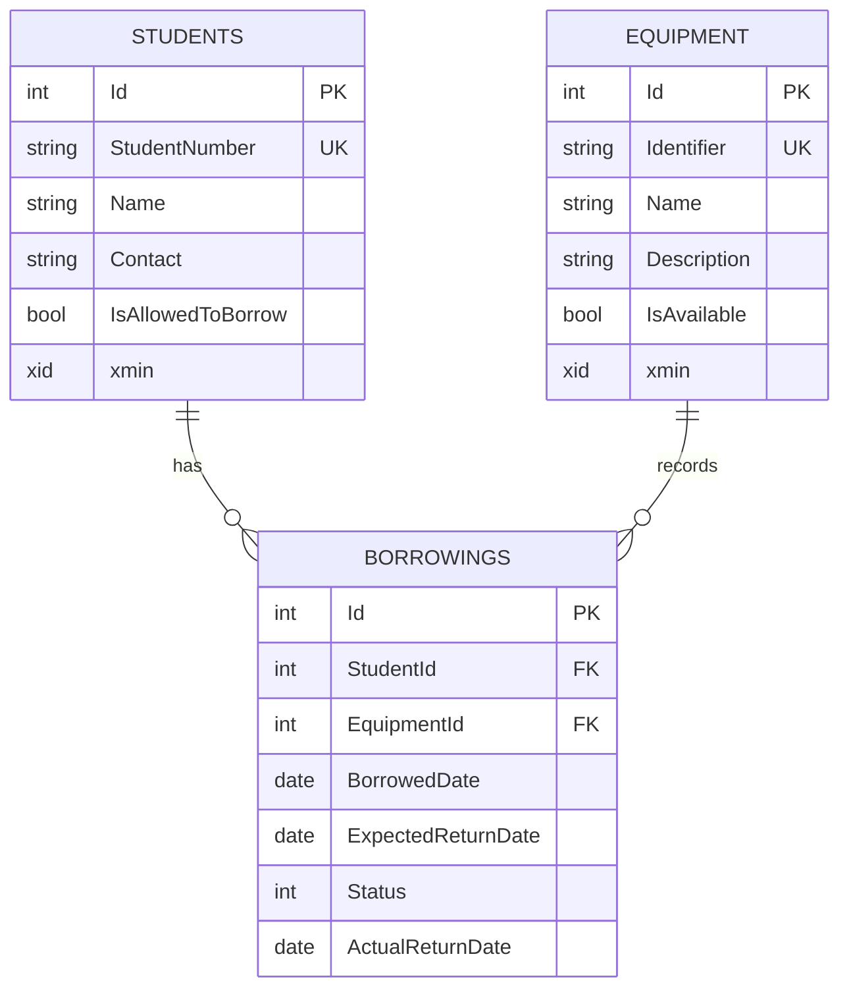

# Schema, migration, and integration decisions

Students.NormalizedNumber and Equipment.NormalizedIdentifier are stored generated columns with unique indexes. They apply upper after trimming exactly the Unicode whitespace characters handled by .NET string.Trim. Descriptive names/identifiers must be nonblank; optional contact/description must be null or nonblank. The application stores a blank optional value as null.

Borrowing.Status uses Active=0, Returned=1. A check constraint requires expected return > checkout, and either active/null actual return or returned/non-null actual return >= checkout. The unique partial EquipmentId index WHERE Status=0 protects against two active records for an item. Foreign keys restrict deletion of referenced students/items. No hard-delete feature exists.

## Migration lineage

The generated PostgreSqlInitial migration creates the three related tables, identities, concurrency mappings, checks, and indexes. HardenWhitespaceIntegrity makes database trimming match application Unicode whitespace handling. The committed EF model snapshot describes the final schema. Use migrate or dotnet ef database update against a clean PostgreSQL database, then optionally seed.

SQLite migrations are archived under docs/legacy-sqlite/Migrations, outside the compiled migration assembly. They remain inspectable alongside the previous README and existing Git history. They must not be applied to PostgreSQL. No existing SQLite file is overwritten.

## Why an operation repository?

The former borrow service performed three independent SaveChanges calls. A failure could therefore persist availability without the corresponding loan. ILabRepository exposes complete application operations, implemented inside one PostgreSQL transaction; LabService owns input normalization and validation and delegates to that abstraction. Database-dependent validation occurs again inside the transaction.

Contexts are created by IDbContextFactory for each operation and disposed promptly. Stateless services/repository can be singleton; they hold only the factory/clock. Read models are detached, so the UI cannot retain a shared context across awaited operations. Failed writes do not leave tracked changes that a later operation might accidentally save.

## Concurrency and transaction boundaries

Checkout first locks one student with FOR UPDATE, reads current eligibility and active records, then locks selected items in ascending internal ID order. A competing checkout for the same student waits before counting; another student's competing request for the same item waits before testing availability. The active-item unique index provides independent database protection. All locks last through commit or rollback.

Return uses the same student/equipment lock order, reloads the borrowing after acquiring locks, rejects repeated returns, and updates the same row and equipment together. Restriction takes the student lock and preserves active loans. All descriptive updates check the selected xmin version and use EF optimistic concurrency to detect intervening changes.

The three-active-item rule is checked under the student lock by every application checkout path. A database administrator who bypasses the application can insert a fourth loan; the assignment's separately enumerated database protections (BR-16) are PK/FK, required fields, identifier uniqueness, and one-active-item integrity. A database-wide active-count trigger was not required.

PostgreSQL documents the transaction-scoped behavior of [FOR UPDATE row locks](https://www.postgresql.org/docs/18/explicit-locking.html). Npgsql documents [xmin concurrency tokens](https://www.npgsql.org/efcore/modeling/concurrency.html).

## Date and failure policies

ManilaCalendar derives the current calendar date in Asia/Manila independently of the host timezone. EF maps all borrowing dates to PostgreSQL date. No UTC timestamp/date mixing is needed for these local calendar rules.

No automatic execution-strategy write retries are enabled. A recognized server constraint/conflict rejection is a known failure. A connection failure before commit reports no commit; connection/timeout/cancellation failure after commit begins is unknown. The UI blocks further writes until successful reload and explicit staff acknowledgement. A save whose commit succeeded but whose subsequent read failed retains its success message with a separate refresh-failure explanation.

The failure tests inject an exception after SQL writes but before commit, and another after a real commit but before acknowledgement is returned to the caller. They are test-only EF interceptors, with no failure switch exposed in the desktop.
