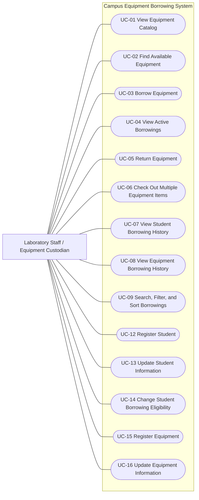

# Lab 4 use cases

The **Laboratory Staff / Equipment Custodian** operates every required workflow. Students are stakeholders; there is no student self-service/authentication flow. PostgreSQL is the supporting system. Internal validation is not an actor goal, so no include/extend relationships are required.

An equivalent UML use-case diagram source is provided in [use-cases.puml](use-cases.puml).

| ID | Use case | Classification |
|---|---|---|
| UC-01 | View Equipment Catalog | Required continuation |
| UC-02 | Find Available Equipment | Required continuation |
| UC-03 | Borrow Equipment | Required continuation |
| UC-04 | View Active Borrowings | Required continuation |
| UC-05 | Return Equipment | Required continuation |
| UC-06 | Check Out Multiple Equipment Items | Required new |
| UC-07 | View Student Borrowing History | Required new |
| UC-08 | View Equipment Borrowing History | Required new |
| UC-09 | Search, Filter, and Sort Borrowings | Required new |
| UC-10 | View Overdue Borrowings | Deferred to Lab 5 |
| UC-11 | View Current Equipment Holder | Deferred to Lab 5 |
| UC-12 | Register Student | Required new |
| UC-13 | Update Student Information | Required new |
| UC-14 | Change Student Borrowing Eligibility | Required new |
| UC-15 | Register Equipment | Required new |
| UC-16 | Update Equipment Information | Required new |
| UC-17 | Retire Equipment from Circulation | Deferred to Lab 5 |
| UC-18 | Mark Equipment as Under Maintenance | Deferred to Lab 5 |
| UC-19 | Restore Equipment to Circulation | Deferred to Lab 5 |
| UC-20 | Record Equipment Condition Upon Return | Deferred to Lab 5 |
| UC-21 | Renew or Extend an Active Borrowing | Deferred to Lab 5 |
| UC-22 | Return Multiple Equipment Items | Deferred to Lab 5 |
| UC-23 | View Borrowings Due Soon | Deferred to Lab 5 |
| UC-24 | View Student's Active Borrowing Count | Deferred to Lab 5 |
| UC-25 | View Equipment Utilization Summary | Deferred to Lab 5 |
| UC-26 | Manage Equipment Categories | Deferred to Lab 5 |
| UC-27 | Void an Erroneous Borrowing Without Erasing Its History | Deferred to Lab 5 |
| UC-28 | Request an Equipment Reservation | Future scope |
| UC-29 | Approve, Reject, or Cancel Reservations | Future scope |
| UC-30 | Review Staff Action Audit History | Future scope |
| UC-31 | Manage Staff Accounts and Permissions | Future scope |
| UC-32 | Export Borrowing Reports | Future scope |
| UC-33 | Integrate External Services or Notifications | Future scope |

Only fourteen required cases are implemented; no additional deferred-case suite is required.
